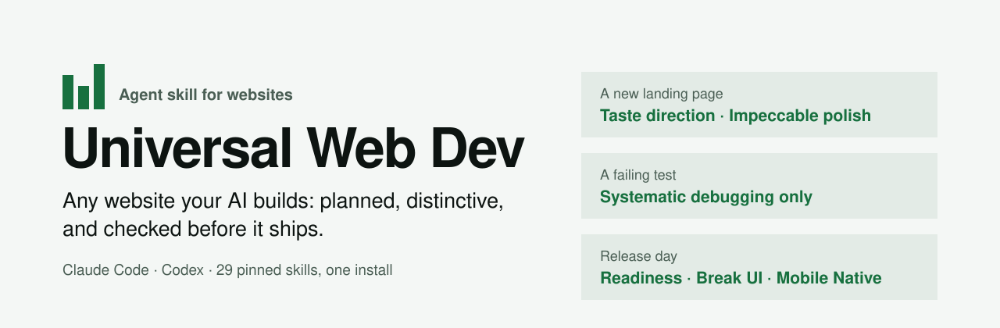
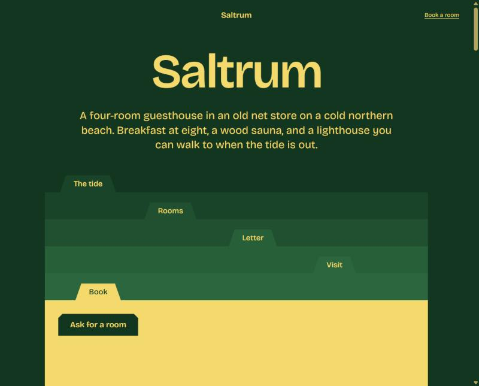
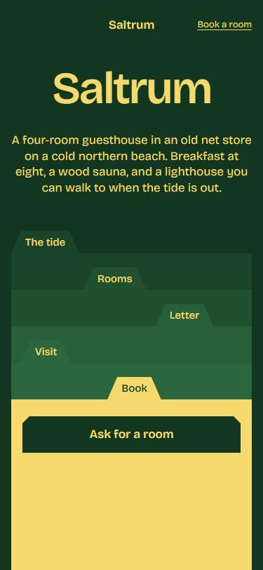
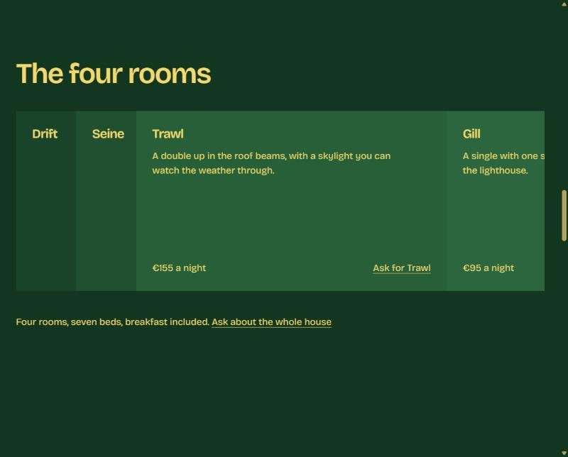

<div align="center">

<picture>
  <source media="(prefers-color-scheme: dark)" srcset=".github/assets/banner-dark.svg">
  
</picture>

<br>

[](https://github.com/generosomm/universal-web-dev/actions/workflows/check.yml)


[](LICENSE)

**[Install](#install-in-one-message)** · **[What you get](#what-you-get)** · **[See a site it built](#see-a-site-it-built)** · **[Included skills](#included-skills)** · **[FAQ](#faq)**

</div>

---

### Your AI can already write a website. This makes it a good one.

Without guidance, AI-built sites drift toward the same look: a centred headline, three icon cards, a soft gradient. They also skip the boring work that makes a site launchable: contrast, mobile, broken links, secrets in the browser.

**Universal Web Dev** is one skill that sits in front of your coding assistant. For each task it picks the right expert skill from 29 community skills and leaves the rest unloaded, so you get a distinctive design, a plan before code, and a release checklist, without paying for every manual on every edit.

<br>

## Install in one message

Paste this into Claude Code, Codex or any coding assistant that can run commands:

```text
install or update universal-web-dev and all of its skills from:
https://github.com/generosomm/universal-web-dev
follow INSTALL.md, preserve my customized skills, and report what changed.
```

That's it. Your assistant downloads this skill plus the 29 skills it uses, each from a reviewed, pinned commit, then runs a check and tells you what it installed. Restart or refresh your assistant afterwards so it sees the new skills.

- **Updating later?** Send the same message. Skills you edited, or installed another way, are kept and reported, never overwritten.
- **Want a smaller setup?** Say "core skills" instead of "all of its skills".

<details>
<summary><strong>Install it yourself instead</strong></summary>

<br>

Needs Python 3.10+. From a clone of this repository:

```sh
python scripts/install.py --host claude --profile all --sync           # preview, changes nothing
python scripts/install.py --host claude --profile all --sync --apply   # install
python scripts/doctor.py --profile all                                 # check
```

Use `--host codex` for Codex, or `--dest <folder>` for any other skills directory. Profiles: `core` (design and workflow), `lean` (adds Caveman), `backend` (API design, security review), `postgres` (Supabase's Postgres guidance), or `all`.

The installer never runs code from the skills it downloads. It keeps backups when it replaces anything and rolls back if an install fails. Details: [INSTALL.md](INSTALL.md).

</details>

<br>

## What you get

**A design that belongs to the client.** Each new page gets its own layout, type and palette, built from what makes that business different from its competitors. Generic AI patterns are banned and checked in a real browser. Your brand or accepted design always wins.

**Context that stays small.** A typo loads nothing extra and a bug loads debugging only. The heavy design manuals load for new pages, not for every edit.

**A site that is ready to launch.** A plan before code, tests for real behaviour, and a release checklist that adapts to the site, so there are no cookie banners or bot walls where they don't belong.

### How it picks skills

| You ask for | It loads | It skips |
| --- | --- | --- |
| A typo or copy fix | nothing extra | all design and backend guidance |
| A bug fix | systematic debugging | design skills |
| A new landing page or portfolio | Taste for direction, Impeccable for the final polish | backend guidance, a second design system |
| A dashboard or admin screen | Frontend Design, UI/UX Pro Max lookups | marketing-page art direction |
| A login, database or API | full-stack contracts, API and security guidance | design skills |
| A release | readiness checklist, Break UI, Mobile Native | anything outside the release |

The full routing lives in [SKILL.md](SKILL.md), which is about 5.7 KB.

### What gets checked before launch

Every item is marked done, pending, or "doesn't apply" with a reason, so a portfolio isn't forced through checks meant for a shop.

| Trust and safety | Found and shared | Works for everyone |
| --- | --- | --- |
| Privacy policy and terms that match what the site does | Meta titles and descriptions | Contrast measured, not guessed |
| No secrets in browser code | Social preview image and favicon | Keyboard focus and alt text |
| HTTPS and secure sessions | Sitemap and robots.txt | Phone, tablet and desktop layouts |
| Cookie consent only where needed | Heading order and structured data | Custom 404 and no broken links |
| Form validation and spam protection | Hreflang for multilingual sites | Fast pages: images, slow scripts |

The full checklist: [website readiness](references/website-readiness.md).

<br>

## See a site it built

A one-page site for a fictional seaside guesthouse, built by following the skill end to end: planning documents, a dealt design direction, tests, browser checks and a final polish pass.

<table>
<tr>
<td width="62%"></td>
<td width="38%" rowspan="2" valign="top"></td>
</tr>
<tr>
<td></td>
</tr>
</table>

The checks caught five real bugs before it was done, including a script error that disabled every feature and a colour that failed contrast. The [code, tests and build record](https://github.com/generosomm/universal-web-dev/tree/main/examples/reference-site) are in `examples/`. The business and its content are fictional.

<br>

## Use it

Describe the work. The skill takes it from there:

```text
use universal-web-dev to plan a booking site for a small dental clinic with staff and admin roles.
```

```text
use universal-web-dev to continue this project's next feature, reuse the existing design,
and verify the whole flow before marking it done.
```

In Claude Code you can also type `/universal-web-dev`; in Codex, `$universal-web-dev`. For a new project it writes short planning documents and a sprint plan before any code, then builds one working feature at a time.

<details>
<summary><strong>Project files it creates for a new site</strong></summary>

<br>

```text
README.md        what exists and how to run it
PROJECT.md       stack, structure, conventions
PRODUCT.md       users, critical flow, what "done" means
DESIGN.md        the visual direction and tokens
docs/
  sprint-plan.md   one status table for the whole build
  testing.md       real test commands
  sprints/S01.md   goal, acceptance, evidence
tests/
  sprints/S01/     tests mapped to acceptance
```

Existing projects keep their own structure. See [project bootstrap](references/project-bootstrap.md).

</details>

<br>

## Included skills

All installed from pinned commits in [dependencies.lock.json](dependencies.lock.json), with authors and licenses in [CREDITS.md](CREDITS.md).

| Skill | By | What it does here |
| --- | --- | --- |
| [Superpowers](https://github.com/obra/superpowers) | Jesse Vincent | Planning, debugging, test-driven development, code review, verification (14 skills; `using-superpowers` and `writing-skills` are loaded by Superpowers itself) |
| [Ponytail](https://github.com/DietrichGebert/ponytail) | Dietrich Gebert | The smallest change that fully solves the task |
| [Humanizer](https://github.com/blader/humanizer) | Siqi Chen | Rewrites website copy that reads AI-written, in your own voice |
| [Taste](https://github.com/Leonxlnx/taste-skill) | Leonxlnx | Art direction that avoids generic AI pages |
| [Frontend Design](https://github.com/anthropics/skills) | Anthropic | Direction for app screens and dashboards |
| [UI/UX Pro Max](https://github.com/nextlevelbuilder/ui-ux-pro-max-skill) | Next Level Builder | Searchable UX, accessibility and stack guidance |
| [Emil's skills](https://github.com/emilkowalski/skills) | Emil Kowalski | Interaction polish, Break UI, Mobile Native, Prototype, Pick UI Library |
| [Impeccable](https://github.com/pbakaus/impeccable) | Paul Bakaus | Final polish, audit and accessibility review |
| [Caveman](https://github.com/JuliusBrussee/caveman) | Julius Brussee | Terse replies when you ask for them *(lean profile)* |
| [API Design](https://github.com/wshobson/agents) | Seth Hobson | REST and GraphQL contracts *(backend profile)* |
| [Security Best Practices](https://github.com/openai/skills) | OpenAI | Security review on request *(backend profile)* |
| [Postgres Best Practices](https://github.com/supabase/agent-skills) | Supabase | Schemas, queries, RLS *(postgres profile)* |

Also recommended, not installed or pinned: reusable components and icons from FeralUI, Motion Primitives, Magic UI, Cult UI, Animata, React Bits, Animate UI, Sonner, Lucide, lucide-animated, itshover, Tabler and Phosphor. Your AI adds them only when a project wants them, restyled to the site's own design. See [component sources](references/component-sources.md) for rules and [credits](CREDITS.md#referenced-not-installed) for authors and licenses.

More skills were vetted and left out, either because they overlap these or because they touch your browser logins, send your work to other services or have no license. [More skills](references/more-skills.md) lists them with the reasons, so your AI can suggest a safe one when a project needs it.

<br>

## FAQ

<details>
<summary><strong>Does installing 29 skills make my assistant slower or more expensive?</strong></summary>

<br>

Barely. An installed skill costs only its one-line description until it's used, and the routing loads full instructions only when a task needs them. `Prototype` and `Pick UI Library` load only when you invoke them yourself, in assistants that honour that setting, such as Claude Code.

</details>

<details>
<summary><strong>Will it overwrite skills I already have or have edited?</strong></summary>

<br>

No. Sync installs missing skills and updates only the copies it installed and you haven't changed. Everything else is kept and listed in the report.

</details>

<details>
<summary><strong>Which AI tools does it work with?</strong></summary>

<br>

Claude Code and Codex have built-in install paths (`--host claude`, `--host codex`). Other assistants that support agent skills work with `--dest <their skills folder>`. A chat-only AI without file and terminal access can't install skills; it can only give you the commands.

</details>

<details>
<summary><strong>Does it pick a framework, database or style for me?</strong></summary>

<br>

No. Your stack, brand and existing design are inputs. Static sites get no invented backend, and business systems get real permission and data rules.

</details>

<details>
<summary><strong>Is Impeccable fully installed?</strong></summary>

<br>

Its design guidance is. Its optional launcher downloads a separate program that isn't pinned, so the installer leaves it out, and Impeccable uses its documented fallback. For live browser mode and its automatic detector, set up its launcher from [the upstream project](https://github.com/pbakaus/impeccable).

</details>

<details>
<summary><strong>How do the pinned versions stay current?</strong></summary>

<br>

Maintainers run `python scripts/check-updates.py`, review any changes to installed files, and release new pins. Your installs update when you send the install message again. See the [release checklist](docs/release-checklist.md) for what has been verified.

</details>

<br>

## Status and limits

Community preview. The installer, checker and a static reference site are tested on Windows and in CI on Linux and Windows. Business-system trials (logins, databases, roles) are next. No skill guarantees bug-free output; this one makes problems visible earlier.

Contributions: follow [AGENTS.md](https://github.com/generosomm/universal-web-dev/blob/main/AGENTS.md), keep changes focused, and include test evidence. Found a problem? [Open an issue](https://github.com/generosomm/universal-web-dev/issues) with your AI tool, setup and what you expected, and remove secrets and private project data first.

The [MIT license](LICENSE) covers this wrapper's own files. Each included skill keeps its own license; none are bundled here, and nothing implies their authors endorse this project.

<div align="center">

<br>

Made by **[Merwin M. Generoso](https://generosomm.dev)** · [GitHub](https://github.com/generosomm)

</div>
